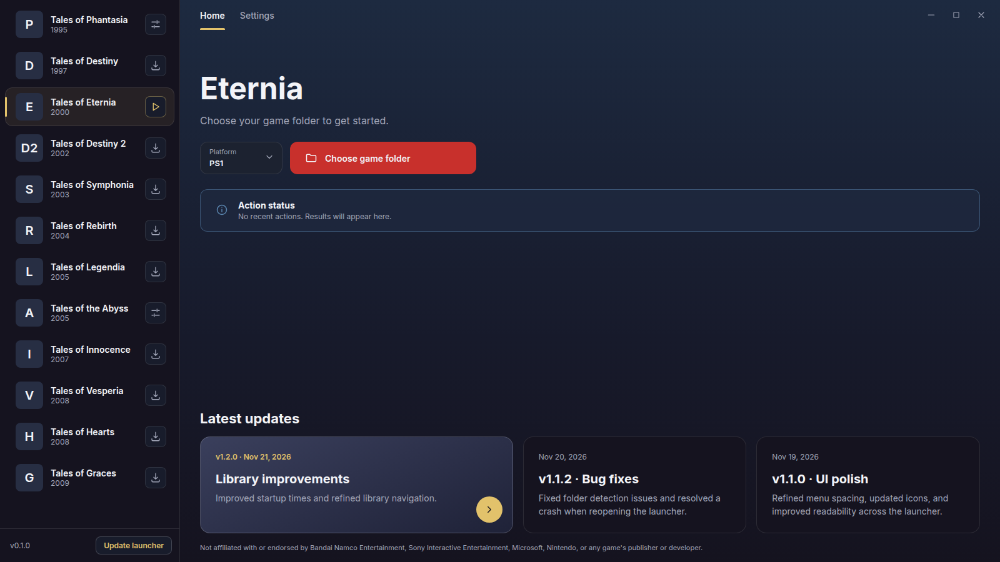

# launcher

to-recomp/launcher

To Recomp Launcher: one place to install, prepare, configure and launch the recompilations of the main Tales of games. Tauri (Rust) with a Svelte 5 + TypeScript frontend. Each recomp stays usable standalone, and releases also work with RecompLauncher through a `recomplauncher.json` manifest.

Status: M0, scaffold (static layout, no backend features yet). UI references are in `design/`.

Not affiliated with or endorsed by Bandai Namco Entertainment, Sony Interactive Entertainment, Nintendo or any game publisher or developer. This project contains no game files; you bring your own copy of the game.

License: GPL v3 (`LICENSE`). Contributions: `CONTRIBUTING.md`.

## Development

Requirements: Node 26, Rust stable, and the [Tauri system dependencies](https://v2.tauri.app/start/prerequisites/) (on Fedora: `webkit2gtk4.1-devel gtk3-devel librsvg2-devel libsoup3-devel`).

```
npm install
npm run tauri dev     # app window with hot reload
npm run verify        # type check + tests with coverage gate + build (what CI runs)
npm test              # frontend tests only
cd src-tauri && cargo fmt --check && cargo clippy --all-targets -- -D warnings && cargo test
```


